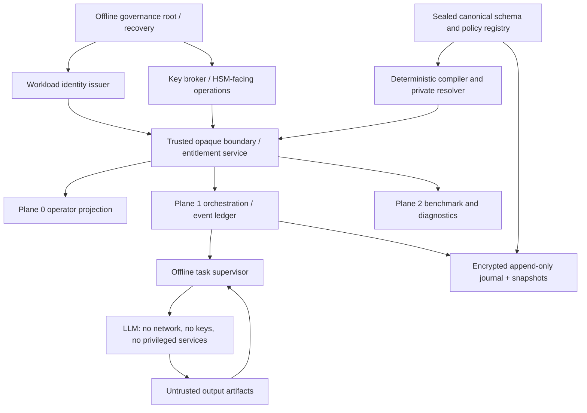

# v6.2 logical architecture and trusted boundaries

Plane -1 is a logical trust boundary, **not** a single superuser image. Separate
the key broker from schema compilation, custody policy, the journal writer and
the human projection gateway. Do not run any private key material in an LLM
process or experimental Rust binary. The operator dashboard sees redacted
projections; full mapping access requires separately authorized, audited
break-glass access.

A generic opaque wire envelope is authenticated transport metadata plus
recipient-only ciphertext. The broker sees a routing token and payload size, not
field names, paths, conversation text or policy expressions. Route tokens are
not used as authorization; sender workload credentials, expiry, current policy,
replay state and recipient binding are checked independently.

Two identically-shaped encrypted message envelopes can have different internal
schemas; routing and operational metadata may remain observable. Metadata
minimization can use bucketed lengths, delayed batch dispatch, scoped rotating
pseudonyms and independent network namespaces. Those techniques have cost and
cannot hide all traffic correlations from the host or physical infrastructure.

Workers still need meaningful _Rust source_. Removing all source symbol names
and paths would frustrate code generation without keeping the lab safe. Give
workers virtual fixed paths (`/workspace/repo`), a pinned repository snapshot
and scoped task text. Never give them the lab's internal schema, secret policy,
mapping catalog or trusted control commands.
