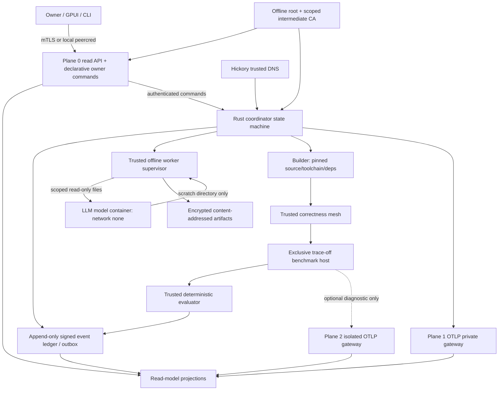

# Topology and information-flow boundaries

## Isolation boundaries and actors

| Domain / container       | Sees                                                              | Does not see / cannot control                                                   | Transport                                  |
| ------------------------ | ----------------------------------------------------------------- | ------------------------------------------------------------------------------- | ------------------------------------------ |
| GPUI / CLI               | permitted public status/lineage                                   | private notebooks, raw holdouts, keys                                           | owner-authenticated mTLS or local socket   |
| API / read projections   | ledger-derived metadata and allowed measurement summaries         | model private plaintext; shell; raw secrets                                     | bounded HTTP and SSE                       |
| Rust coordinator         | IDs, policies, leases, status, signed evidence                    | unshared agent notebooks; arbitrary host command execution                      | trusted mTLS                               |
| Patcher / researcher LLM | mounted task, scoped repo files, explicitly permitted feedback    | internal domain, DNS, CA, tools outside allowlist, siblings, holdouts, Internet | **no network**; file mailbox               |
| Trusted supervisor       | task capsule, local model run, scoped output, visible transcripts | root CA key, sealed holdout, measurement authority                              | trusted mTLS outside worker netns          |
| Builder                  | specific source/recipe and vendored dependencies                  | original researcher private context, untrusted external network                 | trusted scheduling; isolated build process |
| Oracle                   | binaries, trusted tests, sandbox fixtures                         | LLM requests to change trusted tests                                            | controlled execution + signed result       |
| Benchmark host           | frozen binaries, fixtures, protocol, CPU lease                    | patcher's reasoning or model access                                             | isolated executor                          |
| Evaluator                | attested samples and frozen stats policy                          | source mutation or hidden scorer edits                                          | mTLS                                       |
| PKI / DNS                | identity and name metadata, issuance reasons                      | private message plaintext; scientific truth                                     | restricted internal only                   |
| Control OTLP receiver    | metadata and service spans                                        | prompt, source, argv, secrets                                                   | separate mTLS and storage                  |
| Product OTLP receiver    | diagnostics for explicit instrumented runs                        | control-authority actions; production benchmark verdict                         | separate mTLS and storage                  |

**Do not run the model runtime in a host networking namespace shared with the
trusted supervisor.** A long-lived idle supervisor process may exist, but the
actual model process must start in an offline/sandboxed execution domain. IPC
into it is a narrowly typed task capsule and outbox; it does not contain network
addresses or authority credentials.

## Trust semantics

An offline model may infer that it is being benchmarked. That is irrelevant to
access control: its OS-level capabilities still prevent connections to the three
planes. Neither `--network none` nor mTLS alone guarantees security; host,
filesystem, IPC, cgroups and build/test execution must also be segregated.

## Dual telemetry is not dual authority

Control telemetry and product telemetry are never canonical benchmark evidence.
The signed runner samples are canonical. A dropped trace makes diagnostics
incomplete but does not change a trusted measurement. Product tracing is off for
authority-grade timing and enabled in a separate diagnostic binary/experiment.
