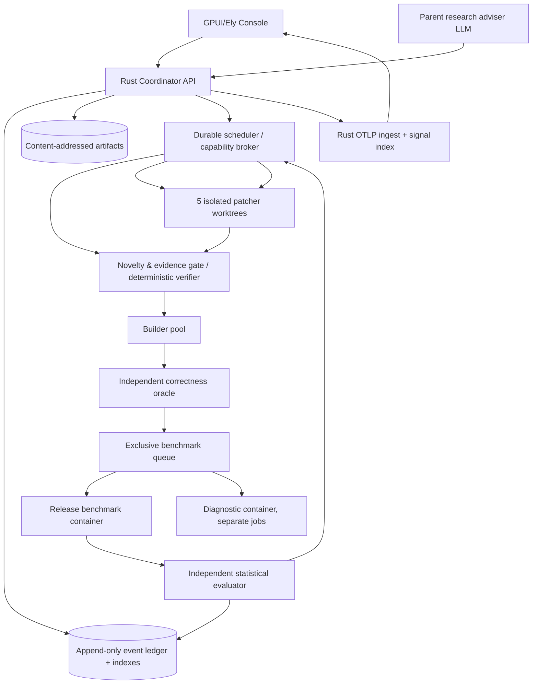

# Architecture: deterministic core, replaceable reasoning edges

## 0. The architecture in one diagram

**Authority:** The coordinator owns the scheduler, evidence, and transitions.
LLMs are untrusted-with-respect-to-measurement advisers/workers. The parent
agent has a wide _read_ view and proposal capability; it does not possess
absolute root authority.

## 1. Key actors

- **Coordinator (Rust service):** typed APIs, durable state transitions, tokens,
  quotas, scheduling, artifact digests, data-view redaction, leases and
  approvals. No model required for deterministic operations.
- **Research director (parent reasoning agent):** sees approved summaries across
  lanes and full controlled source when necessary, chooses domains to explore,
  suggests next-generation fanouts and arbitrates scientific tradeoffs. It
  cannot edit evidence.
- **Patcher worker (child agent):** runs inside a restricted container with a
  single source worktree, target function/module, narrow historical summary,
  task spec and feedback of its own lineage. It writes a patch and reports a
  summary; neither whole-project bench history nor holdout outcomes are
  accessible.
- **Knowledge/novelty gate (deterministic service):** checks syntactic identity,
  canonical patch identity, previously measured experiment keys, semantic
  proximity, source ancestry and known failure reasons. Advisory LLM comparator
  may categorize ambiguous overlaps, but only versioned policies approve/reject.
- **Builder (non-LLM):** reproducibly compiles immutable source using a pinned
  recipe, then hashes and publishes artifacts.
- **Oracle (non-LLM):** evaluates behavioral compatibility independently from
  patcher edits; tests and fixtures come from frozen trusted commits. If an
  agent proposes an oracle adjustment, it is a separate reviewable mutation.
- **Benchmark scheduler / runner (non-LLM):** owns hardware measurement lease,
  applies resource constraints, runs paired workloads, signs/verifies result
  manifests.
- **Statistical evaluator (non-LLM):** analyzes raw samples with a versioned
  protocol; may classify regression, win, inconclusive, invalid.
- **Analyst/critic (LLM, optional):** receives verifier-backed scores, explains
  bottlenecks and proposes future research, never authors truth.

## 2. Five-candidate generation

1. Freeze `base_source_commit`, `baseline_binary_sha256`, `toolchain`,
   `fixture set`, `environment cohort`, `protocol version`, `oracle version`,
   `promotion policy`, and a `generation_id`.
2. Allocate five disjoint mutation scopes or hypothesis families. The workers
   may share a model family but not conversational history, raw rival patches,
   sealed validation samples or exploratory leaderboard.
3. Issue an immutable `task_id` to each patcher with a limited-relevance code
   bundle and a worktree. Workers can be warm/idle but may only receive allowed
   task capabilities after assignment.
4. Each worker commits exactly one conceptual patch and submits `proposal.v3`
   plus content hashes. No free-form summary is enough.
5. Gate checks scope, source ancestor, similarity, patch duplication, feature
   collision, restricted modules and prior exact experiment keys. It can return
   `EXACT_CACHE_HIT`, `NEAR_DUPLICATE`, `NOVEL`, `CONFLICT`,
   `INSUFFICIENT_PROOF` or `INVALID`.
6. Valid novel sources compile in parallel; identical build keys reuse immutable
   artifacts. The oracle runs on each compiled artifact before timing.
7. Runner hosts execute paired comparisons against frozen B0, including repeated
   blocks, order randomization and periodic reference drift checks. Multiple
   ready candidates queue; do **not** run five competing measurements on shared
   cores/disks.
8. Evaluator produces raw evidence references and derived estimates. A selected
   candidate may receive a marginal comparison against its direct parent and, if
   promising, a confirmation on held-out workloads.
9. The patcher receives only a signed structured feedback capsule for its own
   lineage (effect, error classes, controlled aggregate hints); it is permitted
   to revise in a **new child mutation** of the original patch or move to a new
   branch. Never silently change the tested source.
10. The director receives generation summaries with budget and progress signals.
    It can trigger a new fanout, cancel unpromising tracks or request
    independent integration experiments.

## 3. State and message ownership

`CAMPAIGN_ACTIVE -> GENERATION_FROZEN -> TASK_ALLOCATED -> PATCH_SUBMITTED -> NOVELTY_CHECKED -> COMPILED -> ORACLE_PASSED -> MEASUREMENT_QUEUED -> MEASURED -> ANALYZED -> CONFIRMATION_ELIGIBLE -> REVIEWED -> ACCEPTED|REJECTED|INCONCLUSIVE`

Intermediate failure/retry events: `LEASE_EXPIRED`, `PATCH_INVALID`,
`ALREADY_KNOWN`, `BUILD_FAILED`, `ORACLE_FAILED`, `BENCH_CONTAMINATED`,
`RESULT_QUARANTINED`, `BUDGET_EXHAUSTED`, `WORKER_RESTARTED`, `HUMAN_HALT`.

Every transition is emitted as an append-only typed envelope with actor ID,
`previous_state`, `next_state`, reason, logical sequence, external artifact
hashes and request idempotency key. State is projected from events; the event
sequence is not an instruction to a language model.

## 4. The context and measurement boundaries

**No direct benchmark result delivery from runner to patcher.** Runner pushes
signed result references to coordinator; evaluator verifies and computes
statistics; policy builds scoped feedback and sends it to assigned patcher. This
ensures a worker cannot selectively suppress unfavorable samples and cannot use
hidden validation results as a free training set.

**Agents do not own tools by convention alone.** Container capabilities and
broker-enforced API scope matter more than prompts. A child sees the assigned
worktree, trusted task spec and narrow feedback; no source monorepo sibling
worktrees, no private dataset paths, no provider credentials, no benchmark
engine Docker socket, and no direct query to event DB. The parent sees
role-appropriate campaign summaries and a controlled deep-inspection interface;
parent proposals are checked just like child proposals.

**Build source and benchmark source are immutable.** Build outputs are
CAS-addressed and read-only in runners. Benchmark fixture manifests and oracle
source are not under patcher control.

## 5. Recursive depth and stopping policy

A patch lineage is a linear causal chain: `B0 -> P1 -> P1a -> P1b`. A generation
can fan out to multiple chains, forming a DAG. Merging `P1b` with `P3c` is a new
integration candidate with both ancestors, a newly compiled binary and entirely
new evidence. Do not inherit a sum of speedups from parents.

Stop/re-scope a lane when repeated null results occur, the expected-value
estimate drops below cost, novelty falls, semantic failures repeat, or
confidence cannot be established within budget. Use a finite per-lane depth,
global attempt cap, token budget, hourly wall-clock cap, disk quota and a
watchdog with heartbeats. Manual review is a hard gate before any release.

## 6. Containment zones

- **Zone 0: host custody:** Docker daemon, CPU reservations, CAS root, secure
  tokens, full event store, signed run manifests.
- **Zone 1: coordinator and evaluators:** can allocate resources, read
  artifacts, validate outcomes; cannot rewrite append-only facts.
- **Zone 2: builder/oracle/runner:** separate restricted purposes; only
  measurement runner touches reserved benchmark CPUs and fixtures.
- **Zone 3: patcher/critic/scout:** isolated read views, individual worktrees,
  no direct control over measurement resource or evidence.
- **Zone 4: dashboard:** read-only by default, with authenticated, audited
  mutations through coordinator APIs only.

The primary threat model here is _epistemic contamination_, but implement
ordinary container hardening as defense in depth: rootless workers,
seccomp/AppArmor, no Docker socket, capability drop, resource limits, scoped
mounts and network egress policies.

## 7. Rust-first implementation modules

`lab-coordinator` (durable scheduler, API), `lab-agent-gateway` (model adapters
and conversation ledger), `lab-patch-gate` (identity, semantic proximity),
`lab-builder` (OCI build adapter), `lab-oracle` (trusted correctness),
`lab-runner` (benchmark plans + leases), `lab-statistics` (paired analysis),
`lab-store` (CAS + event ledger), `lab-otel` (OTLP receiver/query), `lab-ui`
(GPUI/Ely), `prun-instrumentation` (product-only optional feature).

For prototype deployment, one Rust daemon can host the coordinator, evaluator,
gate, control API and OTLP ingestion, plus separate containerized task
executors. Split process boundaries only when they improve isolation,
scheduling, or operational clarity. Do not force microservices for their own
sake.
