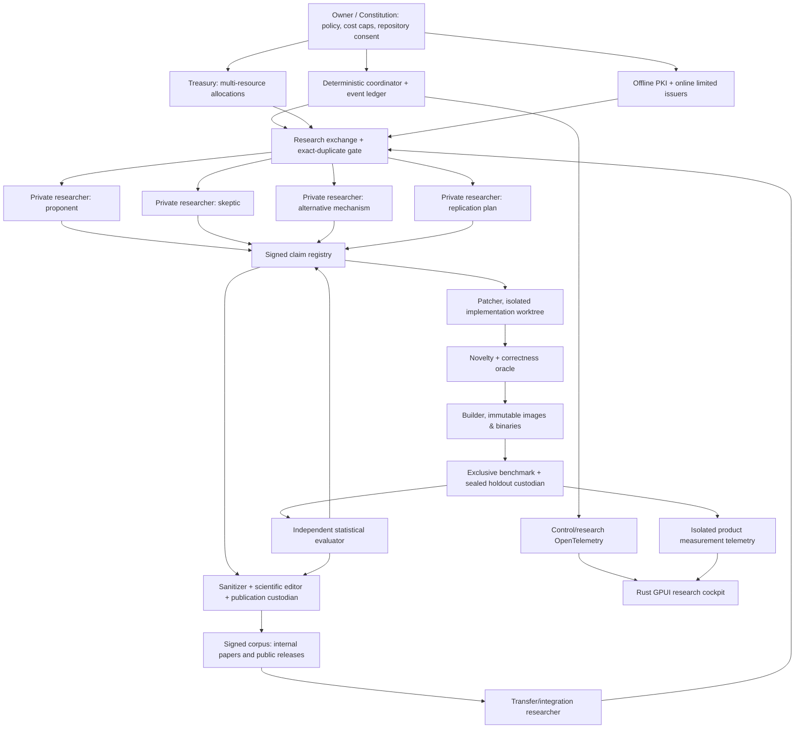

# v5 System Architecture — Research Economy, not an LLM Debate Club

## 1. Objective and scope

Create a locally operable, Rust-first, Docker-managed, evidence-centered
research system that can be applied to any consenting/authorized source
repository with a valid adapter. Each **atomic mutation** (one conceptual
algorithmic change) receives a pre-registered **research case**, where
independent researchers examine different mechanisms, argue against one another
only in explicitly managed later phases, make measurable predictions, and
publish separately traceable findings.

Contributions:

- a continuously running, durable research-exchange scheduler;
- identity-bound, compartmentalized research notebooks and claims;
- a resource-constrained competitive allocation market;
- an independently operated experiment and review institution;
- a declassification/publishing institution and a second, distinct cross-project
  integration institution;
- a reusable repository adapter for arbitrary languages, test runners and
  artifact formats;
- separate telemetry for agent/research/benchmark planes.

**Non-goals / hard boundaries:** no guarantee of 'ultimate speed'; no trusted
evidence derived purely from LLM text; no automatic public release of private
repositories; no incentive to maximize publications, benchmarks run, or raw
output volume; no assumption that a container prevents its host operator from
reading secrets; no assumption that agents using the same model are
statistically independent.

## 2. Institution graph

Raw agent-private notebooks never connect directly to the public library, the
evaluator, or sibling researchers. The knowledge publisher sees only explicitly
authorized decrypted inputs and produces a distinct signed, sanitized derivative
with provenance links (possibly private) to its parents.

## 3. Authority versus knowledge

The **Owner** may set priorities, hard resource limits and publication policy.
The owner is not presumed entitled to plaintext for conversations encrypted to
other designated recipients; the platform operator may still be technically
capable of accessing containers/files without additional trusted
hardware/operational controls.

The **Coordinator** knows all allowed experiment IDs, budgets, status
transitions, identities and lineage. It is deterministic and not an LLM. It
cannot independently alter measurements, decrypt arbitrary messages, infer
hidden paper content, approve publications, or create new unlimited credits.

The **Research Exchange** evaluates signed bids, reserves compute, enforces
diversity/anti-duplication and publishes receipts. It cannot define its own
allocation policy or create money.

The **Patcher** owns only the source view and task it needs. Patches are
submitted as content-addressed diffs against pinned parent commits, not by
allowing an agent to write into the canonical repository.

The **Experiment authority** owns fixture definitions, oracle acceptance, sample
integrity, cohort identity and benchmark leases. Researchers cannot rewrite
these.

The **Publication authority** validates evidence linkage and policy-compliant
sanitization, but never upgrades an unreplicated claim to a proven result just
because its prose is persuasive.

The **Integrator** can propose applying a result elsewhere, but cannot mark it
as portable until it passes a distinct target-repository experiment.

## 4. Research-case lifecycle

`opened -> blind_assigned -> preregistered -> source_reviewed -> patch_optional -> oracle_checked -> measured -> evaluated -> peer_critiqued -> replicated_or_unconfirmed -> publication_review -> sealed_internal|released_public -> available_for_transfer`.

A case may branch into multiple independent opinion streams; an individual
mutation track is single-parent, with integration/merges represented as
explicitly new candidate IDs. There is no in-place editing of prior claims. All
revisions append signed superseding records.

For a trivial change (e.g. lint fix), the system may assign a minimal cheap
researcher; for performance-critical changes, it may allocate a proponent,
skeptic, alternative and replication designer. Escalation is policy-driven to
avoid expensive four-agent theatrics on every tiny patch.

## 5. Decision states

`opinion` != `preregistered_prediction` != `source_verified` != `oracle_pass` !=
`performance_confirmed` != `independently_replicated` != `publication_eligible`
!= `release_approved`.

Every stage has a separate signed authority, explicit predecessor requirements
and an immutable evidence fingerprint. Failed, negative and inconclusive cases
remain searchable.

## 6. Recursion contract

Paper publication is NOT allowed to directly patch production code. A new
transfer hypothesis creates a _new_ research case and budget request, along with
original paper references. A new patch must pass source/oracle/benchmark gates
afresh. Success on repo A, CPU X, input D is not evidence of success on repo B,
CPU Y, input E.

A policy may fund 'research about research': e.g. search strategies, prompt
templates, experimental design or resource allocation. Such changes use
**meta-experiments** with separate holdouts and immutable coordinator policies;
no agent may mutate the policy used to evaluate its own policy changes.

## 7. Scaling dimensions

Scale researchers, replicas, repositories and host machines independently. All
work orders are typed by required hardware, privacy class, trust domain, model
access, budget and evidence split. Workers request work using signed capability
tokens; coordinator assigns leases with fencing tokens. A task can be retried
idempotently after lease expiry; duplicate receipts do not create duplicate
expenses or publications. Externally hosted nodes must be enrolled in the trust
domain and run host validation before they can produce measurement-grade
evidence.

A federation of repositories is a federation of _contexts_, not a single shared
worktree. Shared knowledge is sanitized; source, secrets, raw prompts and
benchmarks remain repository-scoped by default.
